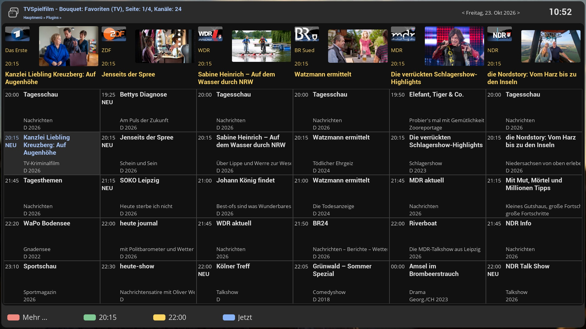

# TVMagazineCockpit (TVC)

TVMagazineCockpit is a TV guide for your set-top box, laid out like a printed TV magazine: six channels side by side,
the programmes of each channel running down the page, and a row at the top that shows what is on at prime time.
It takes the channels from one of your bouquets and the programme data from a TV-magazine website, so it works for
the whole bouquet and for the next two weeks, independently of what your satellite or cable EPG delivers.

This wiki describes version **0.13.1**.

## What it does

- **Magazine view.** Six channels per page, five programmes each, all columns aligned on the same time.
  See [User Guide](User-Guide.md).
- **Prime time at a glance.** Each column starts with the channel logo, a picture and the title of the programme
  that runs at 20:15 on the chosen day.
- **Two weeks ahead.** Step through the days from yesterday to 14 days ahead.
- **Jump to a time.** Show 20:15, 22:00 or the current time in all columns with one key.
- **Details with picture and trailer.** Description, year, duration, a picture, and (with TVSpielfilm) a trailer.
  See [Event Details](Event-Details.md).
- **Act on a programme.** Zap to the channel, add a recording timer, search the Mediathek, or look it up in
  TMDB. See [Actions](Actions.md).
- **Three data sources** to choose from: TV Für Alle, TV Movie, TV Spielfilm. See [Data Sources](Data-Sources.md).
- **A "NEU" badge** for new episodes (TV Spielfilm).

## Pages

| Page | For | Content |
|---|---|---|
| [Installation](Installation.md) | everyone | Requirements, installing, what happens at start-up |
| [User Guide](User-Guide.md) | everyone | The screen, the grid, days and times |
| [Keys and Buttons](Keys-and-Buttons.md) | everyone | Every key |
| [Event Details](Event-Details.md) | everyone | The details screen and the trailer |
| [Actions](Actions.md) | everyone | Zap, timer, Mediathek, TMDB |
| [Data Sources](Data-Sources.md) | everyone | The three sources compared, network use |
| [Channels](Channels.md) | everyone | Which channels appear, the channel dictionary, adding your own |
| [Settings](Settings.md) | everyone | Every setting |
| [Cache](Cache.md) | advanced | The daily cache in `/data/TVC` |
| [Troubleshooting](Troubleshooting.md) | everyone | Problems, logging, limitations |
| [Architecture](Architecture.md) | developers | Files, data flow, the event record, the skin |

## Related plugins

| Plugin | Relation |
|---|---|
| MediathekCockpit | Optional: adds *Mediathek search* to the actions menu |
| TMDBCockpit | Optional: adds *TMDB search* to the actions menu |
| ComponentsCockpit, FontCockpit | Skin components and fonts |
| CoverCockpit | Listed as a dependency of the package |

## Licence

GNU General Public License v3.0 or later. Copyright 2018-2026 by xcentaurix.
